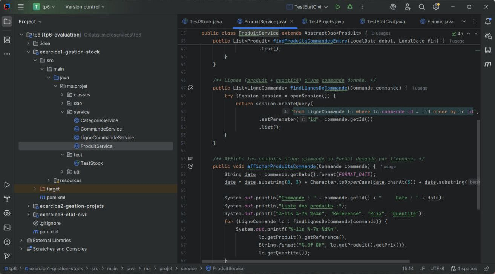
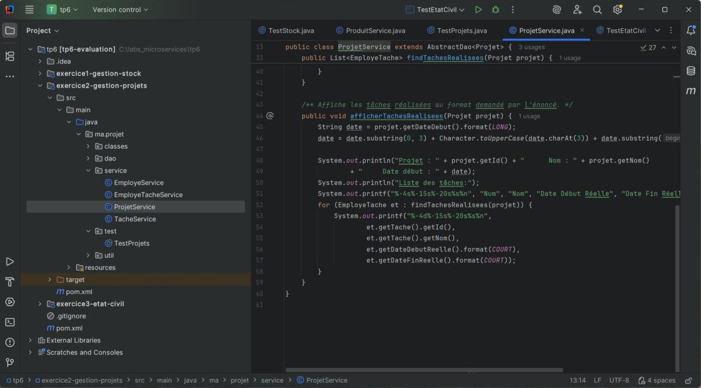
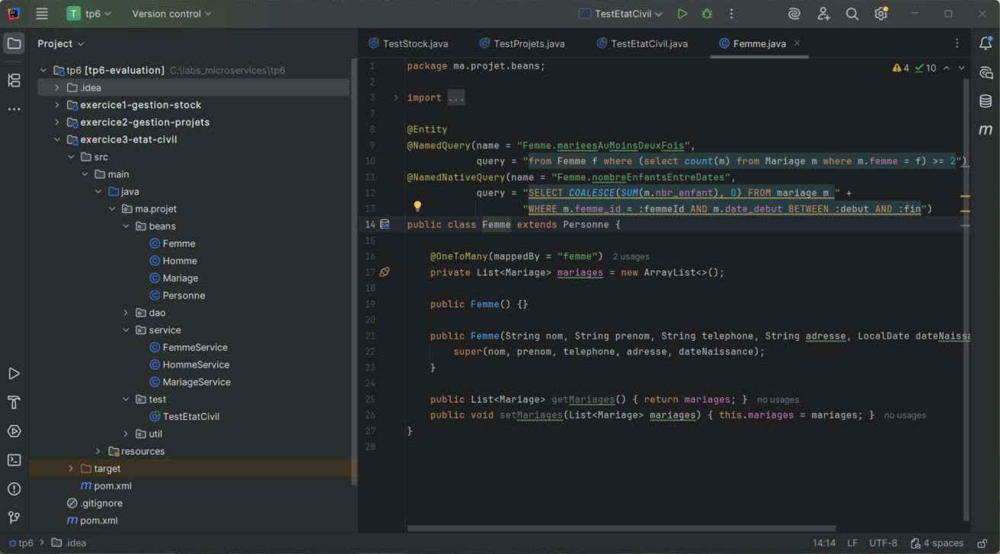
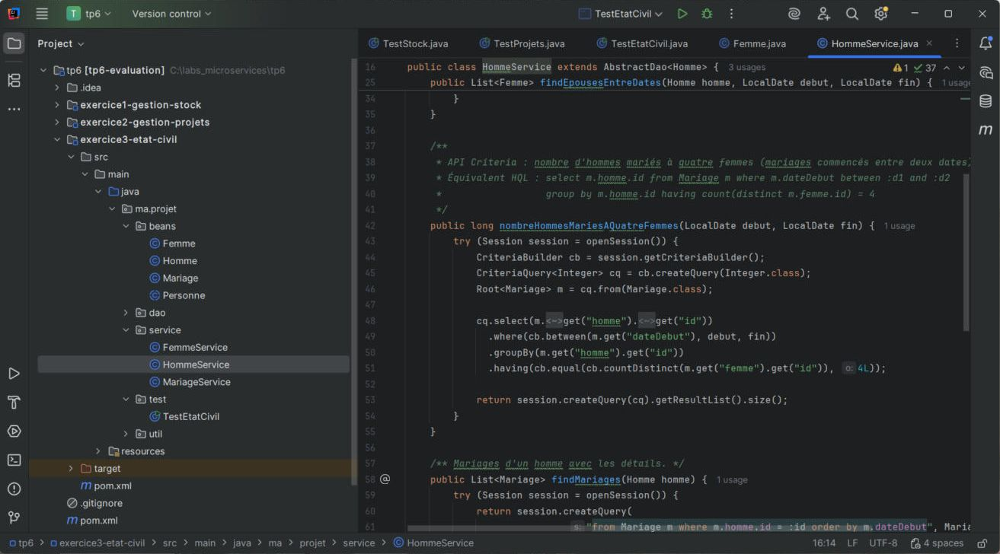

# TP 6 – Évaluation : 3 applications Hibernate / MySQL

> Module : **Architecture Microservices – Conception, Déploiement et Orchestration**

Ce TP d'évaluation met en pratique tout ce qui a été vu sur **Hibernate** en développant trois applications indépendantes :

| # | Application | Ce qu'on manipule |
|---|-------------|-------------------|
| 1 | **Gestion de stock** | Catégories, produits, commandes, lignes de commande · HQL · requête nommée |
| 2 | **Gestion de projets** | Employés, projets, tâches, réalisations · HQL avec jointures · requête nommée |
| 3 | **Gestion de l'état civil** | Hommes, femmes, mariages · `@MappedSuperclass` · requête **native** nommée · **API Criteria** |

Les trois exercices sont réunis dans un **projet Maven multi-modules** (un module par exercice), ouvert d'un seul bloc dans IntelliJ.

---

## Sommaire

1. [Technologies](#technologies)
2. [Architecture commune](#architecture-commune)
3. [Exercice 1 – Gestion de stock](#exercice-1--gestion-de-stock)
4. [Exercice 2 – Gestion de projets](#exercice-2--gestion-de-projets)
5. [Exercice 3 – Gestion de l'état civil](#exercice-3--gestion-de-létat-civil)
6. [Lancer le projet](#lancer-le-projet)
7. [Résumé du TP](#résumé-du-tp)

---

## Technologies

| Outil | Version |
|-------|---------|
| Java | 17 |
| Maven (multi-modules) | 3.x |
| Hibernate Core | 5.6.15.Final |
| MySQL Connector/J | 8.0.33 |
| IntelliJ IDEA | 2025.2 |

## Architecture commune

```
tp6/
├── pom.xml                         # POM parent (packaging pom) : dépendances communes
├── exercice1-gestion-stock/
├── exercice2-gestion-projets/
└── exercice3-etat-civil/
    └── src/main
        ├── java/ma/projet
        │   ├── classes/ (ou beans/)   # entités JPA
        │   ├── dao/
        │   │   ├── IDao.java          # interface générique CRUD
        │   │   └── AbstractDao.java   # implémentation générique avec Hibernate
        │   ├── service/               # un service par entité + méthodes métier
        │   ├── util/HibernateUtil.java
        │   └── test/                  # programme de test
        └── resources/application.properties
```

Chaque module respecte les packages demandés par l'énoncé : `ma.projet.classes` (ou `ma.projet.beans` pour l'exercice 3), `ma.projet.dao`, `ma.projet.service`, `ma.projet.util`.

**Choix techniques communs**

- **`application.properties`** contient la connexion MySQL et les options Hibernate. `HibernateUtil` le charge (`Properties.load`), le passe à `Configuration.addProperties(...)` et déclare les entités avec `addAnnotatedClass(...)`. Une seule `SessionFactory` est créée.
- **`IDao<T>`** définit `create`, `update`, `delete`, `findById`, `findAll`.
- **`AbstractDao<T>`** implémente ce CRUD **une seule fois**, chaque écriture étant faite dans une transaction (commit, ou rollback en cas d'erreur). Chaque service (`ProduitService`, `TacheService`, `HommeService`…) hérite d'`AbstractDao` et n'écrit que ses méthodes spécifiques.
- **`hibernate.hbm2ddl.auto=create`** : les tables sont recréées à chaque lancement, donc les programmes de test repartent d'une base propre.
- Les dates sont des **`LocalDate`** (supportées nativement par Hibernate 5).

---

## Exercice 1 – Gestion de stock

### Modèle

```
Categorie (1) ────< (N) Produit (1) ────< (N) LigneCommande (N) >──── (1) Commande
 code, libelle          reference, prix         quantite                    date
```

`LigneCommande` est l'association entre une commande et un produit, avec un attribut : la **quantité**.

### Méthodes de `ProduitService`

| Méthode | Technique | Requête |
|---------|-----------|---------|
| `findByCategorie(c)` | HQL | `from Produit p where p.categorie.id = :id` |
| `findProduitsCommandesEntre(d1, d2)` | HQL + navigation | `select distinct lc.produit from LigneCommande lc where lc.commande.date between :debut and :fin` |
| `afficherProduitsCommande(c)` | HQL + affichage formaté | `from LigneCommande lc where lc.commande.id = :id` |
| `findPrixSuperieur(100)` | **Requête nommée** `Produit.findPrixSuperieur` | `from Produit p where p.prix > :prix` |



### Sortie attendue de `TestStock`

```
===== 1. Produits de la catégorie « Écrans » =====
EE85      200 DH  (Écrans)
ES12      120 DH  (Écrans)

===== 2. Produits commandés entre 2013-02-01 et 2013-03-01 =====
ZR85      100 DH  (Stockage)
AB10       80 DH  (Stockage)

===== 3. Produits de la commande n°4 =====
Commande : 4     Date : 14 Mars 2013
Liste des produits :
Référence   Prix    Quantité
ES12        120 DH  7
ZR85        100 DH  14
EE85        200 DH  5

===== 4. Produits dont le prix est supérieur à 100 DH (requête nommée) =====
ES12      120 DH  (Écrans)
EE85      200 DH  (Écrans)
```

---

## Exercice 2 – Gestion de projets

### Modèle

```
Employe (1) ──chef de──< (N) Projet (1) ────< (N) Tache
   │                                               │
   └────────< (N) EmployeTache (N) >───────────────┘
              dateDebutReelle, dateFinReelle
```

- `Tache` contient les dates **planifiées** et le **prix**.
- `EmployeTache` enregistre qui a **réalisé** la tâche, avec les dates **réelles**.

### Méthodes

| Service | Méthode | Requête |
|---------|---------|---------|
| `EmployeService` | tâches réalisées par un employé | `select et.tache from EmployeTache et where et.employe.id = :id` |
| `EmployeService` | projets gérés par un employé | `from Projet p where p.chefProjet.id = :id` |
| `ProjetService` | tâches planifiées d'un projet | `from Tache t where t.projet.id = :id` |
| `ProjetService` | tâches réalisées avec dates réelles | `from EmployeTache et where et.tache.projet.id = :id` (+ affichage formaté) |
| `TacheService` | prix > 1000 DH | **requête nommée** `Tache.findPrixSuperieur` |
| `TacheService` | tâches réalisées entre deux dates | `select distinct et.tache from EmployeTache et where et.dateDebutReelle >= :debut and et.dateFinReelle <= :fin` |



### Sortie attendue de `TestProjets` (extrait)

```
===== Tâches réalisées avec les dates réelles =====
Projet : 1      Nom : Gestion de stock     Date début : 14 Janvier 2013
Liste des tâches:
Num Nom            Date Début Réelle   Date Fin Réelle
1   Analyse        10/02/2013          20/02/2013
2   Conception     10/03/2013          15/03/2013
3   Développement  10/04/2013          25/04/2013

===== Tâches dont le prix est supérieur à 1000 DH (requête nommée) =====
2   Conception     prévue du 2013-03-01 au 2013-03-15   1500 DH
3   Développement  prévue du 2013-04-01 au 2013-04-30   4000 DH
```

---

## Exercice 3 – Gestion de l'état civil

### Modèle

```
            Personne  (@MappedSuperclass : nom, prénom, téléphone, adresse, date de naissance)
             ▲      ▲
         Homme      Femme
           │          │
           └──< Mariage >──┘   dateDebut, dateFin (null = en cours), nbrEnfant
```

`@MappedSuperclass` : il n'y a pas de table `personne`. Les colonnes communes sont recopiées dans les tables `homme` et `femme`.

### Les 4 techniques de requête utilisées

| Besoin | Technique | Où |
|--------|-----------|----|
| Épouses d'un homme entre deux dates | **HQL** | `HommeService.findEpousesEntreDates` |
| Nombre d'enfants d'une femme entre deux dates | **Requête native nommée** (`@NamedNativeQuery`, SQL MySQL) | `Femme` + `FemmeService.nombreEnfantsEntreDates` |
| Femmes mariées au moins deux fois | **Requête nommée** (`@NamedQuery`, HQL avec sous-requête) | `Femme` + `FemmeService.findMarieesAuMoinsDeuxFois` |
| Hommes mariés à 4 femmes entre deux dates | **API Criteria** (`CriteriaBuilder`, `groupBy`, `having`, `countDistinct`) | `HommeService.nombreHommesMariesAQuatreFemmes` |





> **Remarque :** la requête « mariées au moins deux fois » utilise une **sous-requête** plutôt qu'un `group by m.femme`. Avec MySQL 8 (mode `ONLY_FULL_GROUP_BY`), sélectionner une entité entière avec un `group by` sur son seul identifiant provoque une erreur.

### Programme de test `TestEtatCivil`

Il crée **10 femmes et 5 hommes**, puis 12 mariages, dont ceux de l'exemple de l'énoncé, et affiche :

1. la liste des femmes ;
2. la femme la plus âgée → `BENNANI FATIMA` ;
3. les épouses de SAFI SAID entre 1989 et 2000 → 4 femmes ;
4. le nombre d'enfants de KARIMA ALAMI entre 1985 et 2000 (requête native) → `2 enfant(s)` ;
5. les femmes mariées deux fois ou plus (requête nommée) → KARIMA ALAMI, SAMIRA IDRISSI ;
6. le nombre d'hommes mariés à 4 femmes entre 1985 et 2005 (Criteria) → `1 homme(s)` ;
7. les mariages de SAFI SAID avec les détails :

```
Nom : SAFI SAID
Mariages En Cours :
1. Femme : SALIMA RAMI    Date Début : 03/09/1990    Nbr Enfants : 4
2. Femme : AMAL ALI       Date Début : 03/09/1995    Nbr Enfants : 2
3. Femme : WAFA ALAOUI    Date Début : 04/11/2000    Nbr Enfants : 3

Mariages échoués :
1. Femme : KARIMA ALAMI   Date Début : 03/09/1989
   Date Fin : 03/09/1990    Nbr Enfants : 0
```

---

## Lancer le projet

1. Démarrer **MySQL** sur `localhost:3306`.
2. Vérifier `hibernate.connection.username` / `password` dans le fichier `src/main/resources/application.properties` de chaque module. Les bases `gestion_stock`, `gestion_projets` et `etat_civil` sont créées automatiquement.
3. Ouvrir le dossier `tp6` dans IntelliJ (projet Maven : les 3 modules sont détectés).
4. Lancer `ma.projet.test.TestStock`, `TestProjets` et `TestEtatCivil`.

---

## Résumé du TP

- **Persistance** : entités JPA annotées, relations `@ManyToOne` / `@OneToMany`, classe d'association avec attributs (`LigneCommande`, `EmployeTache`, `Mariage`) et héritage avec `@MappedSuperclass` (`Personne`).
- **Configuration** : `application.properties` chargé par `HibernateUtil`, qui crée une seule `SessionFactory`.
- **DAO générique** : `IDao<T>` + `AbstractDao<T>` évitent de réécrire le CRUD dans chaque service.
- **Requêtes** : HQL avec navigation et jointures implicites (`lc.commande.date`, `et.tache.projet.id`), **requêtes nommées**, **requête SQL native nommée** et **API Criteria** (`groupBy` / `having`).
- **Tests** : un programme par exercice, qui crée des données puis valide chaque fonctionnalité avec l'affichage demandé par l'énoncé.
